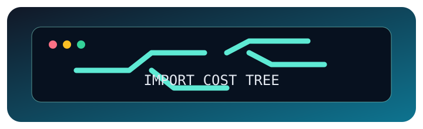

<p align="center"></p>
<p align="center"></p>
<p align="center">   </p>
<p align="center"></p>

## 🧭 Overview
Python Import Time Tree parses output from CPython's `-X importtime` option and presents nested imports with self and cumulative timings. It does not import or execute the target application.

## ✨ Features
- 🌳 Reconstruct nested import depth from CPython output
- ⏱️ Show self-time and cumulative-time values in microseconds
- 📦 Export parsed rows as JSON for further analysis
- 🔒 Parse an existing log file; never execute the target code

## 🖥️ Demo
No hosted demo is provided. Run the tool locally using the quick-start command.

## 🚀 Quick Start
Requires Python 3.10 or newer.

```bash
python main.py importtime.log
```

Run the test suite with:

```bash
python -m unittest discover -s tests -v
```

## 🧰 Tech Stack
- Python standard library
- `argparse` CLI and `unittest`
- Read-only inspection by default

## 🗂️ Folder Structure
```text
.
├── .github/workflows/ci.yml
├── assets/mark.svg
├── tests/test_main.py
├── main.py
├── pyproject.toml
└── README.md
```

## 🗺️ Roadmap
- [ ] Add more edge-case fixtures
- [ ] Improve machine-readable output
- [ ] Keep the core workflow dependency-free

## 🤝 Contributing
Issues and focused pull requests are welcome. Add regression tests for parser and reporting changes.

## 📄 License
MIT License. See [LICENSE](LICENSE).

<p align="center"></p>
